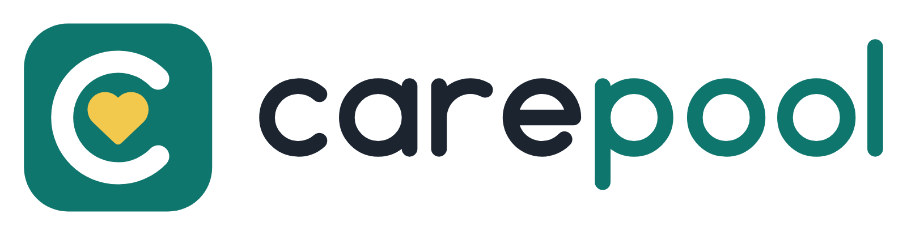
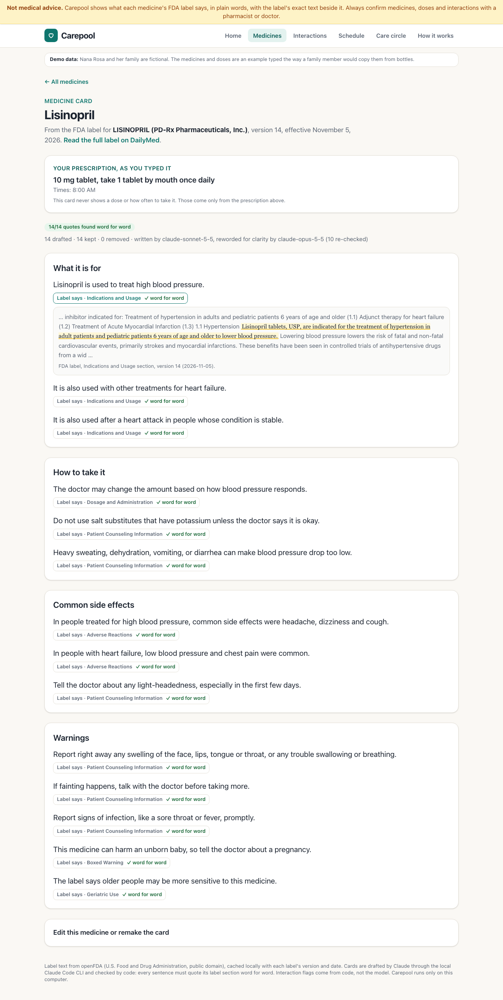

<p></p>

# Carepool

**A family care coordinator for an older relative's medicines.** You type the medicine list exactly as the prescription bottles say. Carepool fetches each medicine's real FDA label and turns it into a plain-language card in which **every sentence quotes the label word for word**, and a program deletes any sentence whose quote it cannot find. It flags pairs of medicines that one label names together, quoting that label. It builds a daily schedule **only from the doses and times you typed**. And it lets the family share the work: recurring jobs like refill pickups and dose checks, a "today" page for each person, and a way to ask for, and offer, cover.

> **Not medical advice.** Carepool shows what FDA labels say, in plain words, with the label's exact text beside every sentence. Confirm every medicine, dose and interaction with a pharmacist or doctor. The demo household ("Nana Rosa", 78, and her family) is fictional.



## What it does

| | |
|---|---|
| **Real FDA labels** | Each medicine's label comes from the [openFDA drug label API](https://open.fda.gov/apis/drug/label/) (free, no key). Carepool picks the exact single-ingredient label, in the release form and route you have (a plain `limit=1` search returned the lisinopril + hydrochlorothiazide combination label, the newest "metformin" label was extended-release, and the newest immediate-release "furosemide" label was the injection). If it has to fall back, the card says "Check the bottle". Every response is cached in `data/label-cache/`, so the demo is reproducible and works offline. Each card shows the label's version and effective date and links to DailyMed. |
| **Cards that cite** | Four parts: what it is for, how to take it, common side effects, warnings. Every sentence names a label section and quotes it. The checker removes a sentence if the quote is not in that section word for word, if the section does not fit that part of the card, if a number in the sentence is not in its quote, if it makes more than one statement, or if it mentions a dose amount or how often to take it. Failed sentences get one repair round, then a review pass may only reword (each reworded sentence is checked again). |
| **Interaction flags** | Code, not the model, reads each label's Drug Interactions, Boxed Warning, Contraindications and Warnings sections for every other medicine's name, brand or drug class, and quotes the sentence it found. The model may explain a flag in plain words (each sentence with its own checked quote); it cannot create one. |
| **Schedule from your words** | The schedule builder's only input is what you typed. It never takes a dose from a label, never suggests one, and never picks a time: a medicine with no clock time goes to "no time entered". |
| **Care circle** | Family members, recurring tasks (morning dose check, weekly pill organizer, refill pickup every 30 days), and a "today" page per person. Dose checks list the doses you typed for that time. "I can't today" puts a task up for grabs; anyone else can tap "I'll take it". |
| **Doctor visit sheet** | A printable sheet to bring to the doctor or pharmacist (**Visit sheet**, then **Print this sheet**): each medicine with the dose and times exactly as you typed them ("not entered" when blank), the label each card used (version, date, DailyMed link), every flagged pair with the label's own words and the section they came from, and the same "ask the pharmacist" questions as the home page. Nothing on it is written for it: every sentence is one the app already shows. Print styles only, no PDF library; a medicine or a pair is never split across pages (the demo household prints on two pages). |
| **Larger text** | A header button for older readers that enlarges the whole app, remembered on this device. |
| **Safety banner** | On every screen, and on the printed sheet. |

## Run it

Requirements: Node.js 22 or newer and npm. For live cards: [Claude Code](https://docs.claude.com/en/docs/claude-code) installed and signed in (`claude` on your PATH). Nothing else: no API key, no account, no paid service.

```bash
npm install
npm run setup -- --reset --with-cards   # fictional Nana Rosa household + the cards recorded from a real model run
npm run dev                             # http://localhost:3300
```

That opens the demo with real cards (recorded by `npm run live`, see below) and works without the internet. To make cards live on your machine, press **Remake all cards** on the Medicines page: each step is one `claude -p` call through your local Claude Code sign-in, about a minute per card.

Other ways to run it:

```bash
npm run setup -- --reset                          # the household with no cards yet; press "Make the medicine cards"
CAREPOOL_PROVIDER=mock CAREPOOL_OFFLINE=1 npm run dev   # no model at all: scripted cards, red MOCK MODE banner
PORT=3400 npm run dev                             # another port (3300 is the default)
```

## Commands

| Command | What it does |
|---|---|
| `npm run dev` | The app on port 3300 (`PORT` to change). |
| `npm run setup -- --reset [--with-cards]` | Create `data/carepool.db` and load the fictional household (and the recorded cards). |
| `npm run live` | The real end-to-end run: reseeds, makes all five cards and the flag explanations with the local Claude CLI, re-checks every quote, records the result to `data/demo/live-run-nana-rosa.json`. |
| `npm run eval` | Evaluation v0 over 10 common medicines with the real model; writes `eval/results.md` and `eval/results.json`. |
| `npm run labels -- <names>` | Fetch and cache labels (prints which label was chosen and why). |
| `npm test` | Unit and integration tests (vitest). |
| `npm run test:e2e` | Browser tests (Playwright) on a fresh seeded database in mock, offline mode, port 3310. |
| `npm run lint` / `npm run typecheck` / `npm run build` | ESLint, `tsc --noEmit`, production build. |
| `npm run screens` | Screenshots into `docs/screens/` (see the script header for the server it expects). |
| `npm run record` | A silent screen capture of the demo, cut to `DEMO_SCRIPT.md` (needs ffmpeg). |
| `npm run brand` | Regenerate the logo files (`src/app/icon.svg`, `src/app/apple-icon.png`, `docs/brand/`) from `src/lib/brand.ts`. |

Configuration is optional; see `.env.example` (provider, model aliases, review on/off, repair rounds, concurrency, timeouts, database path, offline mode).

## How it works

```
 you type ──► medicines (name, dose as typed, clock times)
                 │                                   │
                 ▼                                   ▼
   openFDA label (cached)                  schedule builder (code)
                 │                           only your doses and times
                 ▼
   Claude drafts sentences ──► checker (code) ──► repair once ──► review (reword only) ──► checker again
        {part, text,             quote in section?                                         kept sentences
         section, quote}         right section? numbers in quote?                          = the card
                                 one sentence? no dose?
                 │
                 ▼
   interaction matcher (code): names / brands / class phrases in each label's warning sections
                 │
                 ▼
   Claude explains each flag (each sentence quotes the label; checked) ──► interaction page
```

`EXPLAIN_IT.md` walks through this in two minutes of plain words.

## Evaluation

`npm run eval` runs 10 common medicines through the same pipeline with the real model, and scores the deterministic interaction matcher against 10 pairs hand-checked from the label text. Full table and method: [`eval/results.md`](eval/results.md).

Latest run (2026-11-17, `claude-sonnet-5-5` writes, `claude-opus-5-5` reviews, labels from the committed cache):

| | Result |
|---|---|
| Medicines | 10 common medicines for older adults; 10 of 10 cards produced in 3.0 min |
| Sentences drafted / kept | 135 / 132 |
| Kept sentences whose quote is word for word in the label | **132 / 132**. That is 100% by construction (the checker removes anything else); the eval re-checks it against the raw openFDA field in the cache file, and all 132 are also byte-exact. |
| Failed the first check | 12: 10 cited a label section that does not fit that part of the card, 1 carried a dose, 1 had a number its quote did not. One repair round fixed 10; 2 were removed, plus 1 duplicate of another sentence's quote. |
| Review pass | 103 rewordings accepted, 1 reverted because the reworded sentence failed the checker |
| Meaning check (a second model judges each sentence against its own quote) | **109 / 132 (83%) fully supported**, 23 partly supported (the sentence adds a detail, cause or condition its quote does not state), 0 unsupported. Every partial one is listed with the reason in `eval/results.md`. A model's opinion, not a pharmacist's. |
| Interaction matcher, 10 hand-checked pairs | **precision 5/6 (83%), recall 5/6 (83%)**. One miss (the label said "beta-adrenergic antagonists"), one false alarm ("increase diuretics" in heart-failure advice). |

The real end-to-end run on the Nana Rosa household (`npm run live`, recorded in `data/demo/live-run-nana-rosa.json`): 5 of 5 cards, 65 of 65 kept quotes verbatim, 3 sentences removed by the checker (all on metformin: two cited a section that does not fit their part of the card, one repeated another sentence's quote), the 3 label-stated pairs flagged, 5 flag explanations kept, 87 seconds.

## AI disclosure

- **In the product:** card sentences and flag explanations are drafted by Anthropic's Claude (Sonnet writes, Opus reviews), called through the Claude Code CLI (`claude -p`) on the computer running Carepool. The child process gets no tools, no MCP servers and no settings, and the API-key variables are removed from its environment, so it can only use the CLI's own sign-in. Everything the model writes passes through the deterministic checker before anyone sees it. Interaction flags and the schedule involve no model.
- **In building it:** the code, tests and documents were written with Claude Code (Anthropic), directed and reviewed by the author.

## Reused components

Carepool is a new project started on 2026-11-17. Some parts are adapted from the author's earlier open-source project [Dispute Defender](https://github.com/ROROK20/dispute-defender) (MIT). Every reused file:

| Carepool file | From Dispute Defender | What changed |
|---|---|---|
| `src/lib/cards/citations.ts` | `src/lib/agent/citations.ts` | Kept: grounded-token extraction (double-quoted strings, ISO and month-day dates, numbers) and text normalization. Changed: a citation is one label section plus one verbatim quote instead of a list of source ids; new rules (verbatim substring, section must fit the card part, quote length, one sentence per quote, no dose amount or frequency); a curly-quote/dash-insensitive match that stores the exact label substring. Dropped: tracking-number and day-month date tokens. |
| `src/lib/model/claude-cli.ts` | `src/lib/agent/claude-cli.ts` | Kept: the `spawn` wrapper, treating non-JSON output (a usage-limit banner) as an error, reading `structured_output`. Changed: one `--json-schema` call per step instead of an emulated tool-use transcript (`renderTranscript`/`toMessage` removed); `--no-chrome`, an empty temporary working directory, API-key variables removed from the child env, process-group kill on timeout, a concurrency limit, one retry. |
| `src/lib/model/types.ts`, `src/lib/model/index.ts` | `src/lib/agent/anthropic.ts` | Kept: the idea of one model-function type shared by the real model and the mock. Removed: the Messages API client entirely (Carepool has no API-key path). |
| `src/lib/cards/pipeline.ts` | `src/lib/agent/runner.ts` (`checkAndRepair`), `src/lib/agent/review.ts` | Kept: check → send failures back with the reason → re-check → remove; a review that may only reword and is re-checked. Changed: no tool loop (a card's sources are known up front); the review is accepted or reverted per sentence instead of all-or-nothing; duplicate-quote removal. |
| `src/lib/cards/schemas.ts` | `src/lib/agent/schemas.ts` | Kept: zod schemas as the trusted parse, JSON Schemas shown to the model, `formatZodIssues`. Schemas are new. |
| `src/lib/cards/prompts.ts` | `src/lib/agent/prompts.ts` | Kept: the structure (system rules that name the checker, a repair prompt listing each failure with its reason, a reword-only review prompt). All text is new. |
| `src/lib/model/mock.ts` | `src/lib/agent/mock-agent.ts` | Kept: the idea of a scripted provider that drives the real pipeline and is labelled as mock in the UI. Code is new: it quotes real label sentences and plants one unsupported sentence so the checker's removal path is visible. |
| `src/lib/env.ts` | `src/lib/env.ts` | Kept: the zod preprocess helpers and the cached `getEnv`/`resetEnvCache` pattern. Variables are new. |
| `src/lib/db.ts` | `src/lib/db.ts` | Kept: singleton on `globalThis`, WAL, foreign keys, busy timeout, schema on open, `tx`, `parseJson`, `nowIso`. Trimmed. |
| `scripts/record-demo.ts` | `scripts/record-demo.ts` | Kept: one browser and video per scene, trimming blank frames, 1280x720 30 fps normalization, ffmpeg concat. Removed: synthetic narration (`say`), captions and speed-up; scenes are fixed-length and silent for the author's own voice-over. |
| `tsconfig.json`, `eslint.config.mjs`, `postcss.config.mjs`, `.nvmrc` | same files | Copied unchanged. |
| `next.config.ts`, `vitest.config.ts`, `playwright.config.ts`, `.gitignore`, `LICENSE` | same files | Adapted (Carepool's packages, env, ports and paths; MIT text with the project name). Next.js pinned to 15.5.29 and React to 19.1.10 instead of 15.5.4/19.1.1, which carry CVE-2025-66478. |

Everything else (label lookup and caching, label parser, interaction matcher, schedule builder, care circle, database schema, all pages and components, eval, seed) is new code. Third-party packages are listed in `package.json`.

## Data and licenses

- Label text and pharmacologic classes: openFDA (U.S. Food and Drug Administration), public domain. Cached copies in `data/label-cache/` keep the request URL and fetch time.
- Demo data (`data/seed/nana-rosa.json`): fictional people and an example medicine list typed the way a family member would. Not a real prescription and not a recommendation.
- Code: MIT (`LICENSE`).
- Logo and wordmark (`docs/brand/`, `src/app/icon.svg`): drawn for Carepool from circles and lines in `src/lib/brand.ts`, no font or third-party artwork; MIT with the code.

## Credits

- **Data and APIs:** openFDA drug label API and openFDA NDC directory (U.S. Food and Drug Administration; public domain; no key).
- **Libraries:** TypeScript, Next.js, React, Tailwind CSS, better-sqlite3 (SQLite), zod. **Testing:** vitest, Playwright. Exact versions are in `package.json`.
- **Adapted code:** [Dispute Defender](https://github.com/ROROK20/dispute-defender) (MIT), file by file in "Reused components" above.
- **AI:** Claude (Anthropic), through the Claude Code CLI, in the product and in development (see "AI disclosure").

## Limits

- **Meaning is not machine-proved.** The checker proves each quote is real, in the right section, carries no dose, and contains every number the sentence uses. It cannot prove the plain sentence means exactly what its quote says: in the evaluation a second model judged 23 of 132 kept sentences (17%) only partly supported, usually an added detail or reason, such as "because chest pain or a heart attack can happen" next to a quote that only says not to stop without the doctor's advice. That is why the quote is one click away on every sentence, and why the next step is pharmacist raters.
- **The interaction matcher finds words, not pharmacology.** It can miss an interaction a label describes in other words (it missed "beta-adrenergic antagonists" in the evaluation), and it can flag a mention that is not about using two medicines together (the word "diuretics" in heart-failure advice). The broadest class phrase, "diuretic", produces the most unverified flags. A flag is a question for the pharmacist.
- **Labels are not complete.** No flag does not mean safe together. Only the label's text is used: no clinical databases, no dosing logic.
- **Label choice is automatic.** Carepool picks the newest single-ingredient label in the release form and route you typed (by mouth unless the entry says injection, inhaler, patch, cream or drops). Generic labels from different manufacturers usually match, but not always word for word; the card shows which label it used.
- **Local and single-household.** No accounts, no sync between phones; "each person's today page" means each person opens it on this computer or local network. The model step needs a signed-in Claude Code CLI on this computer; without it, use the recorded cards or mock mode.
- **The evaluation is small.** Ten medicines and ten hand-checked pairs, checked by the build agent reading label text, not by a pharmacist.
